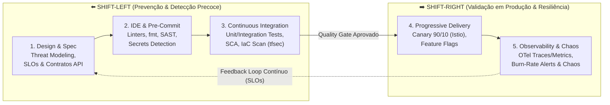
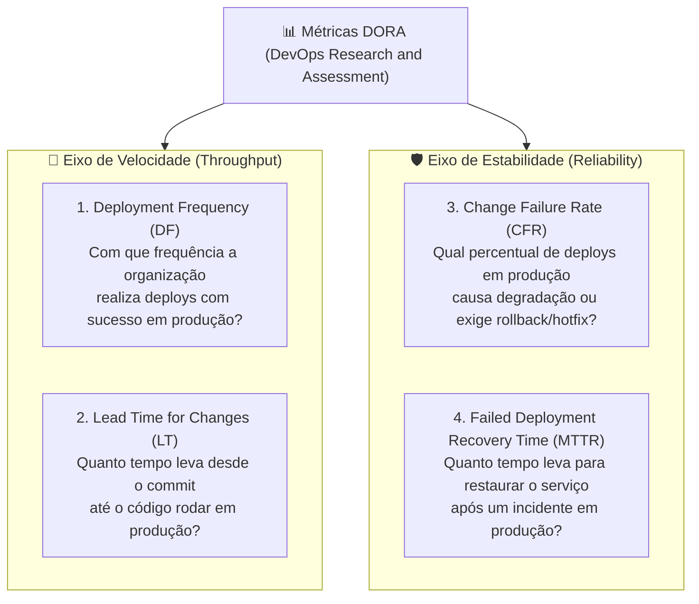

# 📘 Playbook 01 — Cultura DevOps, Shift-Left Quality & Engenharia de Confiabilidade (SRE)

> **Autor:** Prof. Erik Tonon (*Head of Platform Engineering & GenAI @ IBM Consulting*)  
> **Trilha:** Acelera DevOps — Fundamentos de Engenharia de Plataforma, Qualidade Contínua & SRE  
> **Repositórios Práticos Relacionados:** [`observability-stack`](https://github.com/Acelera-DevOps/observability-stack) | [`istio-lab`](https://github.com/Acelera-DevOps/istio-lab)

---

## 1. Da Silagem Tradicional à Cultura DevOps (CALMS)

Historicamente, organizações de tecnologia operavam divididas pelo chamado **"Muro da Confusão"**:
- **Desenvolvimento (Dev)** era incentivado por **velocidade e mudança** (entregar novas funcionalidades no menor tempo possível).
- **Operações (Ops)** era cobrado por **estabilidade e disponibilidade** (onde toda mudança em produção era vista como risco potencial de indisponibilidade).

A cultura **DevOps** elimina esse conflito estrutural ao alinhar incentivos, ferramental e responsabilidade compartilhada (*"You build it, you run it"*). O framework **CALMS** resume os cinco pilares fundamentais dessa transformação:

| Pilar | Significado Prático na Engenharia Moderna |
| :--- | :--- |
| **C — Culture** | Segurança psicológica, *post-mortems* sem culpa (*blameless*), colaboração multifuncional e propriedade ponta a ponta. |
| **A — Automation** | Automação determinística de build, testes, análise de segurança, provisionamento de infraestrutura (IaC) e deploy. |
| **L — Lean** | Lotes pequenos (*small batches*), redução de trabalho em progresso (WIP), eliminação de desperdício (*toil*) e feedback rápido. |
| **M — Measurement** | Decisões orientadas a dados: telemetria de negócio, Métricas DORA, SLIs/SLOs e consumo de *Error Budget*. |
| **S — Sharing** | Repositórios compartilhados, *InnerSource*, catálogos de plataforma, runbooks abertos e disseminação contínua de aprendizado. |

---

## 2. Shift-Left Testing & DevSecOps: Qualidade desde o Primeiro Commit

No modelo tradicional (*Waterfall* ou *Ágil disfuncional*), testes de integração, performance e auditorias de segurança ocorriam apenas no final do ciclo de entrega — dias ou horas antes do *go-live*. Corrigir um defeito arquitetural ou uma vulnerabilidade crítica em produção custa até **100x mais** do que detectá-lo durante a escrita do código.

O movimento **Shift-Left** desloca a validação de qualidade, segurança e operabilidade para a **esquerda do fluxo de entrega** (design, codificação local e Pull Request):

### A Pirâmide de Testes Automatizados e Quality Gates

Uma esteira de Integração Contínua (CI) madura atua como um **Quality Gate determinístico**: nenhum artefato avança para homologação ou produção se violar os critérios objetivos da plataforma:

1. **Testes de Unidade (Base — 70%)**: Executam em milissegundos, isolados de rede ou banco de dados, validando regras de domínio a cada salvamento ou commit.
2. **Testes de Integração e Contrato (Meio — 20%)**: Validam a comunicação real com bancos de dados (via *Testcontainers*), mensageria e contratos de API REST/gRPC (*Consumer-Driven Contracts*).
3. **Testes End-to-End / E2E e Sintéticos (Topo — 10%)**: Validam as jornadas críticas de negócio sob a ótica do usuário final.
4. **Segurança como Código (DevSecOps)**:
   - **SAST (*Static Application Security Testing*)**: Análise estática da árvore sintática do código-fonte.
   - **SCA (*Software Composition Analysis*)**: Auditoria de vulnerabilidades (CVEs) em bibliotecas de terceiros e imagens base de containers.
   - **IaC Scanning**: Verificação estática de Terraform e manifestos Kubernetes (`tfsec`, `trivy`, `checkov`) bloqueando S3 público, ausência de criptografia ou containers rodando como `root`.

---

## 3. Métricas DORA: Medindo Performance de Entrega de Software

O programa **DORA (*DevOps Research and Assessment*)** do Google comprovou empiricamente que **velocidade e estabilidade não são grandezas opostas** — times de elite entregam com maior frequência e, exatamente por entregarem lotes menores e automatizados, apresentam menor taxa de falha.

As **4 Métricas DORA** dividem-se em dois eixos complementares:

| Métrica | Nível Elite (Referência DORA) | Prática Técnica que Destrava o Indicador |
| :--- | :--- | :--- |
| **Deployment Frequency** | Sob demanda (múltiplos deploys por dia) | Trunk-Based Development, CI/CD 100% automatizado e desacoplamento de microsserviços. |
| **Lead Time for Changes** | Menos de 1 hora | Revisão ágil de PRs pequenos, testes paralelos rápidos e provisionamento self-service via IaC. |
| **Change Failure Rate** | `0%` a `5%` | Shift-Left Testing, IaC Scanning, Canary Deployments (ex: Istio `90/10`) e análise automática de métricas. |
| **MTTR (Recovery Time)** | Menos de 1 hora | Observabilidade correlacionada (Métricas + Logs + Traces), rollback automatizado e Feature Flags. |

---

## 4. Estudo de Caso: Modelo Organizacional em Escala (Spotify Squads & Engenharia de Plataforma)

Para escalar agilidade e DevOps sem cair na burocracia de aprovações manuais (CABs tradicionais), organizações de alta performance estruturam times orientados a fluxo com **alta autonomia e alto alinhamento**:

- **Squads**: Times multidisciplinares e autônomos (6 a 10 pessoas) que possuem todas as competências para desenhar, construir, testar, implantar e operar um produto ou domínio de negócio de ponta a ponta.
- **Tribes**: Agrupamento de Squads que atuam em uma mesma área de negócio (ex: Pagamentos, Core Bancário, Experiência do Cliente), mantendo alinhamento estratégico.
- **Chapters**: Comunidades horizontais de especialistas da mesma disciplina técnica (ex: Chapter de SRE/Cloud, Chapter de Backend) dentro de uma Tribe, garantindo padrões de engenharia e evolução técnica.
- **Guilds**: Comunidades orgânicas de interesse transversal a toda a empresa (ex: Guilda de Observabilidade, Guilda de Rust/Go, Guilda de Segurança).

> [!IMPORTANT]
> **O Papel da Engenharia de Plataforma (*Internal Developer Platform - IDP*):**  
> Autonomia de Squad **não significa** que cada time de produto deva reinventar módulos de VPC, configurar clusters Kubernetes do zero ou criar pipelines artesanais. O time de **Platform Engineering** fornece **Golden Paths** (*Caminhos Dourados*) como produto interno (ex: nossos módulos [`terraform-aws-vpc`](https://github.com/Acelera-DevOps/terraform-aws-vpc) e [`terraform-aws-ecs`](https://github.com/Acelera-DevOps/terraform-aws-ecs)), reduzindo a carga cognitiva dos desenvolvedores com segurança e governança embutidas.

---

## 5. Build-to-Manage (BTM) & Prontidão Operacional de SRE

Inspirado nas práticas corporativas de **SRE e Platform Engineering da IBM**, o princípio **Build-to-Manage (BTM)** determina que uma aplicação **só está pronta para produção quando nasce gerenciável, observável e resiliente**:

1. **Instrumentação OpenTelemetry Nativa**: A aplicação exporta métricas (Four Golden Signals), logs estruturados em JSON com `trace_id` e spans de tracing distribuído via protocolo aberto OTLP (veja o laboratório prático em [`observability-stack`](https://github.com/Acelera-DevOps/observability-stack)).
2. **Gestão por SLOs e Error Budgets**:
   - **SLI (*Service Level Indicator*)**: Métrica quantitativa real da experiência do usuário (ex: proporção de requisições HTTP com status `!= 5xx` e latência `P99 < 300ms`).
   - **SLO (*Service Level Objective*)**: Meta interna de confiabilidade (ex: `99.9%` em uma janela móvel de 30 dias).
   - **Error Budget (*Orçamento de Erro*)**: `100% - SLO` (ex: `0.1%` ou `43.2 minutos` de indisponibilidade permitida no mês). Enquanto há orçamento disponível, a Squad prioriza velocidade de entrega; se o orçamento é consumido rapidamente (*Fast Burn*), o foco muda para resiliência e correção estrutural.
3. **Resiliência na Malha de Serviços**: Timeouts explícitos, *Retries* com *Exponential Backoff + Jitter*, *Circuit Breaking* (`OutlierDetection`) e criptografia mTLS mútua delegados ao Data Plane (Envoy/Istio — veja [`istio-lab`](https://github.com/Acelera-DevOps/istio-lab)).

---

## ✅ Checklist de Revisão para Aulas e Entrevistas Sênior

- [ ] Sei explicar por que *velocidade* e *estabilidade* se reforçam mutuamente segundo o relatório DORA?
- [ ] Consigo diferenciar **SLI**, **SLO**, **SLA** e calcular o **Error Budget** mensal de um serviço `99.9%`?
- [ ] Compreendo como o **Shift-Left** combina testes automatizados, SAST/SCA e *IaC Scanning* na pipeline de Pull Request?
- [ ] Entendo como **Platform Engineering** reduz a carga cognitiva de Squads através de *Golden Paths* reutilizáveis?
