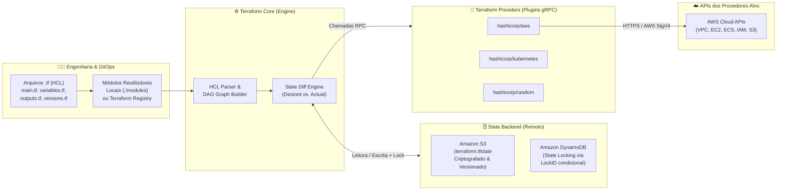
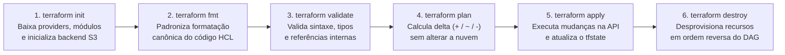

# 📗 Playbook 02 — Fundamentos de Infrastructure as Code (IaC) & Arquitetura HashiCorp Terraform

> **Autor:** Prof. Erik Tonon (*Head of Platform Engineering & GenAI @ IBM Consulting*)  
> **Trilha:** Acelera DevOps — Engenharia de Infraestrutura Cloud-Native & IaC  
> **Repositórios Práticos Relacionados:** [`aula-01-iac`](https://github.com/Acelera-DevOps/aula-01-iac) | [`aula-03`](https://github.com/Acelera-DevOps/aula-03) | [`aula-03-pt3`](https://github.com/Acelera-DevOps/aula-03-pt3) | [`aula-final-ecs`](https://github.com/Acelera-DevOps/aula-final-ecs)

---

## 1. O Que é Infrastructure as Code (IaC)?

**Infrastructure as Code (IaC)** é a prática de gerenciar, provisionar e evoluir recursos de infraestrutura (redes, máquinas virtuais, clusters de containers, bancos de dados, balanceadores de carga e políticas de segurança) através de **arquivos de definição legíveis por máquina e versionados em Git**, em vez de configurações manuais em consoles web (*ClickOps*) ou scripts imperativos frágeis.

### Os 4 Problemas Críticos do Provisionamento Manual (*ClickOps*)

1. **Snowflake Servers (*Servidores Floco de Neve*)**: Ambientes de Desenvolvimento, Homologação e Produção divergem silenciosamente ao longo do tempo (*Configuration Drift*), fazendo com que um código que funcionava em `staging` falhe em `prod`.
2. **Falta de Rastreabilidade e Auditoria**: Mudanças feitas por clique não passam por revisão de pares (*Pull Request*), não possuem histórico imutável de quem alterou uma regra de firewall e por quê.
3. **Baixa Velocidade e Alto Toil Operacional**: Criar uma nova topologia de rede Multi-AZ manualmente leva dias e está sujeito a erro humano; via IaC, leva minutos.
4. **Impossibilidade de Disaster Recovery Confiável**: Em caso de falha catastrófica de uma região cloud, reconstruir dezenas de serviços manualmente sob pressão é inviável.

---

## 2. Pilares Fundamentais da IaC Moderna

| Pilar | Definição Técnica |
| :--- | :--- |
| **Padronização (*Standardization*)** | Módulos validados garantem que toda VPC, bucket S3 ou cluster ECS siga as mesmas normas de segurança, criptografia e *tagging* FinOps (`Environment`, `Owner`, `ManagedBy`). |
| **Idempotência (*Idempotency*)** | Propriedade segundo a qual aplicar a mesma definição de infraestrutura $N$ vezes produz exatamente o mesmo estado final, sem duplicar recursos ou gerar efeitos colaterais indesejados. |
| **Abordagem Declarativa vs. Imperativa** | No modelo **declarativo** (Terraform), descrevemos **o estado final desejado** (*"Quero 3 instâncias EC2 em uma sub-rede privada"*), e o motor calcula o grafo de dependências (DAG) necessário para chegar lá. |
| **Versionamento & GitOps** | O repositório Git é a **Fonte Única da Verdade (*Single Source of Truth*)**. Toda alteração de infraestrutura segue o ciclo: `Branch -> Pull Request -> CI Scan & Plan -> Peer Review -> Merge & Apply`. |

---

## 3. Arquitetura Interna do HashiCorp Terraform

O **Terraform** é uma ferramenta declarativa e agnóstica de provedor (*cloud-agnostic*) escrita em Go. Sua arquitetura é dividida em quatro componentes essenciais:



1. **Terraform Core**: Binário principal que lê os arquivos `.tf` em linguagem **HCL (*HashiCorp Configuration Language*)**, interpola variáveis, constrói o **Grafo Acíclico Dirigido (DAG)** de dependências entre recursos e compara o estado desejado com o estado atual.
2. **Providers**: Plugins independentes comunicando-se via gRPC com o Core, responsáveis por traduzir os recursos abstratos do HCL em chamadas HTTP/SDK reais nas APIs de destino (AWS, Azure, GCP, Kubernetes, Datadog, GitHub).
3. **Terraform State (`terraform.tfstate`)**: Arquivo JSON estruturado que mapeia cada bloco `resource` do seu código para o identificador real (`ID`/`ARN`) do objeto criado na nuvem.
4. **Modules**: Unidades encapsuladas e reutilizáveis de código Terraform que recebem parâmetros de entrada (`variables.tf`), instanciam uma composição lógica de recursos e expõem valores resultantes (`outputs.tf`).

---

## 4. Ciclo de Vida Declarativo do Terraform

Todo fluxo de trabalho profissional com Terraform — seja na máquina do engenheiro ou em um runner do GitHub Actions — respeita a sequência determinística de 6 estágios:



### Boas Práticas no Ciclo de Vida
- **Nunca execute `terraform apply` às cegas**: Em pipelines de produção, o `terraform plan -out=tfplan` gera um artefato binário assinado no Pull Request, revisado pelo time antes da execução de `terraform apply tfplan`.
- **Simbologia do Plano de Execução**:
  - `+ create`: Recurso novo que será provisionado.
  - `~ update in-place`: Recurso existente que será alterado sem recriação.
  - `-/+ destroy and then create replacement`: Alteração em atributo imutável (ex: `ami` de uma EC2 ou `cidr_block` de uma VPC) que força a substituição do recurso.
  - `- destroy`: Recurso removido do código que será excluído na nuvem.

---

## 5. Estado Remoto e State Locking (Amazon S3 + DynamoDB)

Armazenar o arquivo `terraform.tfstate` localmente na máquina do desenvolvedor ou commitá-lo no Git é um **anti-pattern grave de produção** por três motivos:
1. O arquivo de estado pode conter metadados sensíveis em texto claro.
2. Dois engenheiros (ou duas pipelines) executando `apply` simultaneamente sobrescreveriam o estado um do outro, corrompendo a infraestrutura.
3. Não há visibilidade centralizada para o restante da Squad.

### A Solução Enterprise na AWS

```hcl
terraform {
  backend "s3" {
    bucket         = "acelera-devops-tfstate-prod"
    key            = "platform/ecs-cluster/terraform.tfstate"
    region         = "us-east-1"
    encrypt        = true
    dynamodb_table = "acelera-devops-tfstate-locks"
  }
}
```

- **Amazon S3**: Armazena o `terraform.tfstate` com **versionamento habilitado** (permitindo recuperação em caso de acidente), **criptografia Server-Side (AES-256 / KMS)** e **Public Access Block** ativo.
- **Amazon DynamoDB**: Atua como mecanismo de **Mutex / Lock Distribuído** através da chave primária `LockID`. Enquanto uma execução de `plan` ou `apply` estiver ativa, qualquer outra tentativa concorrente aguarda ou falha de forma segura até a liberação do lock.

---

## 6. Casos Reais de Adoção de IaC em Escala (Mercado Financeiro & Big Techs)

Conforme estudado em sala de aula, grandes organizações financeiras brasileiras e empresas globais de tecnologia sustentam milhares de contas cloud e microsserviços usando IaC e Engenharia de Plataforma:

| Organização | Desafio de Escala | Como IaC & Platform Engineering Resolvem |
| :--- | :--- | :--- |
| **Itaú Unibanco** | Modernização massiva de milhares de cargas de trabalho na AWS sob rigorosa regulação do Banco Central (BACEN). | Uso intensivo de módulos Terraform padronizados em catálogos internos (IDP), *Landing Zones* multi-conta automatizadas, *Guardrails* preventivos e observabilidade SRE padronizada. |
| **BTG Pactual** | Agilidade para áreas de *Investment Banking*, *Wealth* e *Digital Retail* com governança estrita de segurança e custos. | Provisionamento 100% automatizado via pipelines CI/CD com validação estática de políticas (*Policy as Code*), segregação de ambientes e módulos corporativos versionados. |
| **Netflix** | Infraestrutura global multi-região na AWS suportando centenas de milhões de streams simultâneos e *Chaos Engineering*. | Imutabilidade de infraestrutura (*Immutable Infrastructure*), automação declarativa de redes/segurança e testes contínuos de resiliência automatizados. |
| **Uber & Airbnb** | Hipercrescimento de milhares de microsserviços, clusters de dados e malhas de serviço globais. | Plataformas internas de auto-serviço (*Self-Service Platforms*) onde engenheiros consomem módulos abstratos de infraestrutura sem tocar diretamente no console da nuvem. |

---

## 🔗 Próximos Passos Práticos na Acelera DevOps

1. Comece pelo **[`aula-01-iac`](https://github.com/Acelera-DevOps/aula-01-iac)** para criar seu primeiro bucket S3 seguro e sua primeira VPC/EC2.
2. Avance para o **[Playbook 03 — Trabalho Prático 1 de IaC na AWS](./03-trabalho-pratico-iac-aws.md)** e implemente a solução completa no repositório **[`aula-02-iac`](https://github.com/Acelera-DevOps/aula-02-iac)**.
3. Domine modularização e GitOps em **[`aula-03`](https://github.com/Acelera-DevOps/aula-03)**, **[`aula-03-pt3`](https://github.com/Acelera-DevOps/aula-03-pt3)** e no projeto final **[`aula-final-ecs`](https://github.com/Acelera-DevOps/aula-final-ecs)**.
