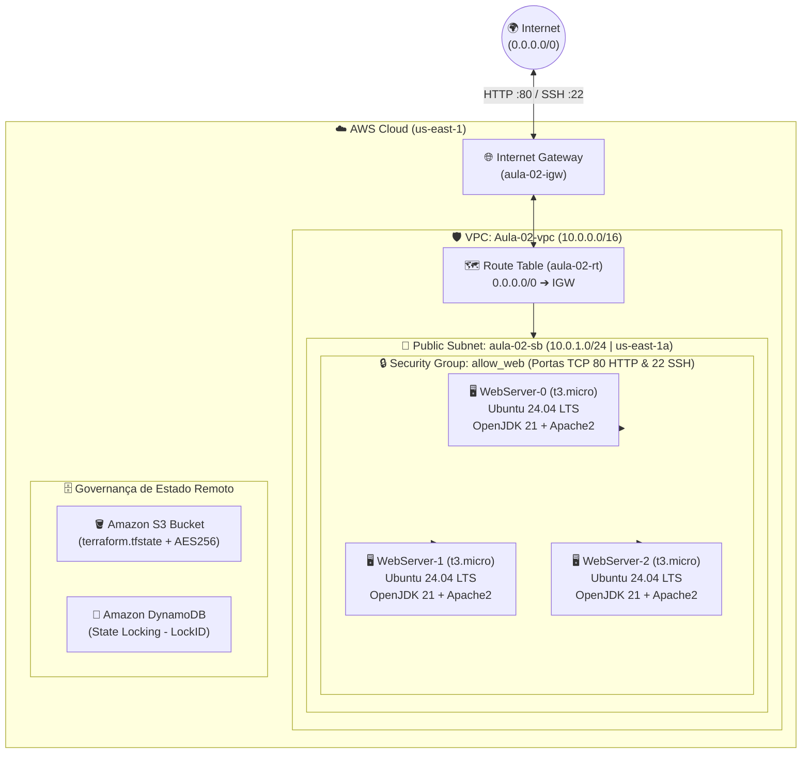

# 📙 Playbook 03 — Especificação Técnica: Trabalho Prático 1 de IaC na AWS (`aula-02-iac`)

> **Autor:** Prof. Erik Tonon (*Head of Platform Engineering & GenAI @ IBM Consulting*)  
> **Trilha:** Acelera DevOps — MBA & Formação Prática em Infrastructure as Code  
> **Repositório de Referência:** [`Acelera-DevOps/aula-02-iac`](https://github.com/Acelera-DevOps/aula-02-iac)

---

## 1. Objetivo do Trabalho Prático

O objetivo deste trabalho prático (**Trabalho 1 de IaC**) é consolidar os conceitos de **provisionamento declarativo**, **redes virtuais na AWS (VPC)**, **segurança de perímetro (Security Groups)**, **bootstrap automatizado de servidores (`user_data`)** e **governança de estado remoto (S3 + DynamoDB)** utilizando o **HashiCorp Terraform**.

Ao concluir este laboratório, o aluno será capaz de erguer — com um único comando `terraform apply` e sem nenhuma intervenção manual no console da AWS — um cluster de **3 servidores Web Ubuntu 24.04 LTS** com runtime **OpenJDK 21** e **Apache HTTP Server (`apache2`)** em execução, retornando os endereços IP públicos e privados como `outputs` estruturados.

---

## 2. Topologia da Arquitetura Alvo



---

## 3. Requisitos Técnicos Obrigatórios

### 3.1. Rede & Conectividade (`VPC`, `Subnet`, `IGW` e `Route Table`)
1. **VPC (`aws_vpc`)**:
   - Bloco CIDR: `10.0.0.0/16`
   - Suporte a DNS e Hostnames habilitados (`enable_dns_support = true`, `enable_dns_hostnames = true`).
2. **Sub-rede Pública (`aws_subnet`)**:
   - Bloco CIDR: `10.0.1.0/24` na zona de disponibilidade `us-east-1a`.
   - Atribuição automática de IP público no lançamento (`map_public_ip_on_launch = true`).
3. **Internet Gateway (`aws_internet_gateway`) & Tabela de Rotas (`aws_route_table`)**:
   - Anexar o Internet Gateway à VPC criada.
   - Configurar rota padrão `0.0.0.0/0` apontando para o `igw.id` e associar explicitamente à sub-rede (`aws_route_table_association`).

### 3.2. Segurança de Perímetro (`Security Group` & `Key Pair`)
1. **Security Group (`aws_security_group.allow_web`)**:
   - **Ingress HTTP (`80/tcp`)**: Permitir tráfego de entrada para acesso ao Apache Web Server.
   - **Ingress SSH (`22/tcp`)**: Permitir tráfego administrativo (recomendado restringir ao seu CIDR público `SEU_IP/32` via variável).
   - **Egress (`-1` / All Traffic)**: Permitir saída para `0.0.0.0/0` para que o `apt-get` possa baixar os pacotes do Ubuntu, OpenJDK e Apache2 durante o boot.
2. **Par de Chaves SSH (`aws_key_pair`)**:
   - Cadastrar chave pública SSH via variável parametrizada (`var.ssh_public_key`), nunca hardcoded com chaves privadas no repositório.

### 3.3. Computação & Bootstrap Automatizado (`3x EC2` + `user_data`)
1. **Descoberta Dinâmica de AMI (`data.aws_ami.ubuntu`)**:
   - Consultar dinamicamente a imagem oficial mais recente do **Ubuntu Server 24.04 LTS (Noble Numbat)** mantida pela Canonical (`owner = "099720109477"`).
2. **Cluster de 3 Instâncias (`aws_instance.web`)**:
   - Utilizar o meta-argumento `count = 3` com `instance_type = "t3.micro"` (ou `t2.micro` Free Tier).
   - Habilitar **IMDSv2 obrigatório** (`http_tokens = "required"`) e volume raiz EBS criptografado (`encrypted = true`).
   - Nomear cada instância dinamicamente com a tag `Name = "WebServer-${count.index}"`.
3. **Script de Inicialização (`user_data`)**:
   - Atualizar repositórios (`apt-get update -y`).
   - Instalar **OpenJDK 21 (`openjdk-21-jdk`)** e **Apache2 (`apache2`)**.
   - Habilitar e iniciar o serviço `apache2` via `systemd` (`systemctl enable --now apache2`).
   - Gerar uma página `/var/www/html/index.html` identificando o hostname da instância e a versão do Java instalada.

### 3.4. Estado Remoto e Lock Distribuído (`S3` + `DynamoDB`)
- Configurar o bloco `backend "s3"` apontando para o bucket S3 de estado remoto com `encrypt = true` e tabela DynamoDB com chave `LockID` para evitar condições de corrida em execuções simultâneas.

### 3.5. Outputs Obrigatórios (`outputs.tf`)
O projeto deve expor ao final do `terraform apply`:
- `vpc_id`: ID da VPC provisionada;
- `web_public_ips`: Lista com os 3 endereços IPv4 públicos das instâncias (`aws_instance.web[*].public_ip`);
- `web_private_ips`: Lista com os 3 endereços IPv4 privados (`aws_instance.web[*].private_ip`);
- `web_urls`: Lista de URLs HTTP prontas para teste (`http://<public_ip>`).

---

## 4. Exemplo de Script `user_data` Modernizado

```bash
#!/bin/bash
set -euxo pipefail
export DEBIAN_FRONTEND=noninteractive

apt-get update -y
apt-get install -y openjdk-21-jdk apache2 curl

systemctl enable apache2
systemctl start apache2

JAVA_VER=$(java -version 2>&1 | head -n 1)
HOSTNAME_VAL=$(hostname -f)

cat <<HTML > /var/www/html/index.html
<!DOCTYPE html>
<html lang="pt-BR">
<head>
  <meta charset="UTF-8">
  <title>Acelera DevOps - Trabalho 1 IaC</title>
</head>
<body style="font-family: sans-serif; background: #0f172a; color: #f8fafc; padding: 2rem;">
  <h1>🚀 Acelera DevOps — WebServer Ativo</h1>
  <p><strong>Hostname:</strong> ${HOSTNAME_VAL}</p>
  <p><strong>Runtime Java:</strong> ${JAVA_VER}</p>
  <p><strong>Provisionado via:</strong> HashiCorp Terraform (user_data)</p>
</body>
</html>
HTML
```

---

## 5. Como Executar e Validar sua Entrega

```bash
# 1. Inicializar providers e backend
terraform init

# 2. Verificar formatação e sintaxe
terraform fmt -check
terraform validate

# 3. Inspecionar o plano de execução (devem constar VPC, Subnet, IGW, RT, SG, KeyPair e 3x EC2)
terraform plan -out=tfplan

# 4. Aplicar a infraestrutura
terraform apply tfplan

# 5. Testar conectividade HTTP nas 3 instâncias
for ip in $(terraform output -json web_public_ips | jq -r '.[]'); do
  echo "Testando http://${ip} ..."
  curl -I "http://${ip}"
done

# 6. Ao encerrar os testes, destruir os recursos para evitar custos na AWS
terraform destroy -auto-approve
```

---

## ✅ Checklist de Avaliação (Critérios de Nota Máxima)

- [ ] **Organização Modular de Arquivos**: Separação limpa entre `versions.tf`, `variables.tf`, `main.tf` e `outputs.tf`.
- [ ] **Zero Hardcoding de Credenciais**: Nenhuma `access_key`, `secret_key` ou chave privada commitada no Git (`.gitignore` configurado corretamente).
- [ ] **Rede Funcional**: `aws_route_table_association` vinculando explicitamente a sub-rede `10.0.1.0/24` à tabela de rotas com saída para o Internet Gateway.
- [ ] **Idempotência e Splat Expressions**: Uso correto de `count = 3` e `aws_instance.web[*].public_ip` nos outputs.
- [ ] **Bootstrap Sem Intervenção Humana**: Apache2 respondendo HTTP `200 OK` na porta `80` e OpenJDK instalado via `user_data` logo após o término do `apply`.
