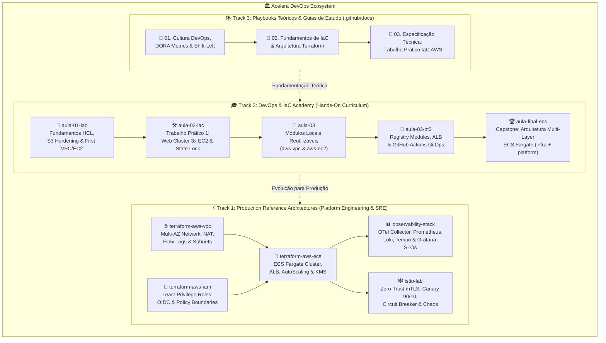

# 🚀 Acelera DevOps — Cloud-Native Platform Engineering, SRE & IaC Academy

**Arquiteturas de Referência Enterprise, Módulos Terraform Production-Grade, Laboratórios de SRE/Service Mesh e Trilha Oficial de Formação em DevOps, Cloud & Platform Engineering.**

Idealizado e mantido por **[Erik Tonon](https://github.com/eriktonon)** — *Head of Platform Engineering & GenAI @ IBM Consulting | Professor de MBA & Especialista em Arquitetura Cloud-Native e SRE*.

---

## 🎯 Sobre a Acelera DevOps

A **Acelera DevOps** une a prática de **Engenharia de Plataforma em escala corporativa** (*Golden Paths*, *Build-to-Manage*, *Shift-Left Security* e *Observabilidade Full-Stack*) com uma **Trilha Acadêmica Hands-On** voltada para engenheiros de software, SREs, arquitetos cloud e alunos de pós-graduação/MBA.

Nosso objetivo é eliminar o abismo entre exercícios acadêmicos simplistas e o que realmente roda em produção em grandes instituições financeiras e empresas nativas digitais: **infraestrutura imutável, estado remoto com lock distribuído, malha de serviços Zero-Trust com mTLS estrito, pipelines GitOps orientados a Quality Gates e observabilidade correlacionada por SLOs e Error Budgets**.

---

## 🗺️ Arquitetura do Ecossistema Acelera DevOps

---

## ⚡ Track 1 — Production Reference Architectures (Platform Engineering & SRE)

Módulos e stacks de referência desenhados sob o princípio **Build-to-Manage (BTM)**: aplicações e infraestruturas que já nascem prontas para operação, seguras por padrão (*Secure-by-Default*) e instrumentadas.

| Repositório | Domínio | Stack & Capacidades Principais |
| :--- | :--- | :--- |
| **[`terraform-aws-vpc`](https://github.com/Acelera-DevOps/terraform-aws-vpc)** | Cloud Networking | Topologia Multi-AZ em AWS, Sub-redes Públicas/Privadas, Internet Gateway, NAT Gateways resilientes, Route Tables explícitas e VPC Flow Logs. |
| **[`terraform-aws-iam`](https://github.com/Acelera-DevOps/terraform-aws-iam)** | Cloud Security & IAM | Identidade e acesso com menor privilégio (*Least Privilege*), federação OIDC para GitHub Actions sem chaves estáticas, *Permissions Boundaries* e políticas auditáveis. |
| **[`terraform-aws-ecs`](https://github.com/Acelera-DevOps/terraform-aws-ecs)** | Container Platform | Plataforma serverless de containers com **AWS ECS Fargate**, Container Insights, Application Load Balancer (ALB), Target Groups, Auto Scaling e criptografia KMS. |
| **[`observability-stack`](https://github.com/Acelera-DevOps/observability-stack)** | SRE & Observability | Stack completa com **OpenTelemetry Collector**, **Prometheus**, **Grafana**, **Loki**, **Tempo** e **Alertmanager**. Inclui alertas de *Multi-Window Multi-Burn-Rate Error Budget* (Google SRE) e correlação nativa *Metrics ↔ Logs ↔ Traces* via Exemplars. |
| **[`istio-lab`](https://github.com/Acelera-DevOps/istio-lab)** | Service Mesh & Chaos | Laboratório Kubernetes de **Istio Service Mesh**: mTLS `STRICT` com identidade SPIFFE, RBAC L7 (`AuthorizationPolicy`), Canary Release `90/10` + roteamento por header, *Circuit Breaking* (`OutlierDetection`) e *Fault Injection*. |

---

## 🎓 Track 2 — DevOps & IaC Academy (MBA & Hands-On Training Curriculum)

Trilha progressiva utilizada em aulas de MBA e treinamentos práticos de **Infrastructure as Code (IaC) com Terraform e AWS**. O aluno evolui desde o primeiro recurso declarativo até uma plataforma distribuída em múltiplas camadas com CI/CD automatizado:

| Etapa | Repositório | O que você aprende na prática |
| :---: | :--- | :--- |
| **01** | **[`aula-01-iac`](https://github.com/Acelera-DevOps/aula-01-iac)** | **Módulo 01 — Fundamentos de IaC, S3 Security & Primeira VPC/EC2**: Sintaxe HCL, ciclo de vida (`init`, `fmt`, `validate`, `plan`, `apply`, `destroy`), bucket S3 com criptografia/versionamento/Public Access Block e provisionamento de VPC + EC2. |
| **02** | **[`aula-02-iac`](https://github.com/Acelera-DevOps/aula-02-iac)** | **Módulo 02 — Trabalho Prático 1 (`Trabalho 1 IaC`)**: Cluster Web com 3 instâncias EC2 (`count = 3`), rede `10.0.0.0/16`, Security Groups restritivos, bootstrap automatizado via `user_data` (Ubuntu 24.04 LTS + OpenJDK 21 + Apache2) e Remote State no S3 com Lock no DynamoDB. |
| **03.1** | **[`aula-03`](https://github.com/Acelera-DevOps/aula-03)** | **Módulo 03 (Parte 1) — Modularização Local & Reuso**: Refatoração de código monolítico em módulos locais desacoplados (`modules/aws-vpc` e `modules/aws-ec2`), contratos de entrada/saída (`variables.tf` / `outputs.tf`) e estado remoto. |
| **03.2** | **[`aula-03-pt3`](https://github.com/Acelera-DevOps/aula-03-pt3)** | **Módulo 03 (Parte 2 & 3) — Registry Modules, ALB & GitOps CI/CD**: Consumo de módulos oficiais do Terraform Registry (`terraform-aws-modules/vpc/aws`), balanceamento de carga L7 com Application Load Balancer (ALB) e esteira GitOps no GitHub Actions (`plan` em PR, `apply` no merge). |
| **04** | **[`aula-final-ecs`](https://github.com/Acelera-DevOps/aula-final-ecs)** | **Projeto Capstone — Plataforma Enterprise AWS ECS Fargate Multi-Layer**: Separação arquitetural em duas camadas de estado independentes (`1-infra` para VPC/Rede e `2-platform` para ECS Fargate + ALB + AutoScaling) conectadas via `terraform_remote_state`. |

---

## 📚 Track 3 — Playbooks Teóricos & Guias de Estudo (`docs/`)

Documentação técnica em português, revisada e modernizada a partir do material didático das aulas do Prof. Erik Tonon:

1. 📘 **[01 — Cultura DevOps, Shift-Left Quality & Engenharia de Confiabilidade (SRE)](https://github.com/Acelera-DevOps/.github/blob/main/docs/01-cultura-devops-e-shift-left-qualidade.md)**
   - Do muro da confusão ao modelo **CALMS** e **Build-to-Manage (BTM)**;
   - **Shift-Left Testing & DevSecOps**: Pirâmide de testes, SAST, SCA, IaC Scanning (`tfsec`/`trivy`) e Quality Gates;
   - **Métricas DORA** (*Deployment Frequency*, *Lead Time for Changes*, *Change Failure Rate*, *MTTR*) e estudo de caso **Spotify Squads**.
2. 📗 **[02 — Fundamentos de Infrastructure as Code (IaC) & Arquitetura HashiCorp Terraform](https://github.com/Acelera-DevOps/.github/blob/main/docs/02-fundamentos-iac-e-terraform.md)**
   - Por que IaC? Padronização, idempotência, imutabilidade e controle de versão;
   - Arquitetura interna do Terraform (*Core*, *Providers*, *State*, *Modules*) e ciclo de vida declarativo;
   - Gerenciamento de Estado Remoto (S3 + DynamoDB Locking) e casos reais de adoção em escala (**Itaú Unibanco, BTG Pactual, Netflix, Uber e Airbnb**).
3. 📙 **[03 — Guia e Especificação Técnica: Trabalho Prático 1 de IaC na AWS (`aula-02-iac`)](https://github.com/Acelera-DevOps/.github/blob/main/docs/03-trabalho-pratico-iac-aws.md)**
   - Enunciado completo modernizado, arquitetura da topologia `10.0.0.0/16` e requisitos de segurança;
   - Passo a passo de implementação com Ubuntu 24.04 LTS, OpenJDK 21, Apache2 via `user_data` e checklist de avaliação.

---

## 🛠️ Princípios de Engenharia Adotados em Todos os Repositórios

- **Deterministic Syntax-First Verification**: Todos os repositórios contam com validação automatizada via GitHub Actions (`terraform fmt -check`, `terraform validate`, `tflint`, `tfsec`, validação de schemas YAML/JSON e Kubernetes).
- **Security Shift-Left**: Criptografia em repouso habilitada por padrão, bloqueio de acesso público em buckets S3, containers non-root com filesystem read-only, IMDSv2 obrigatório em instâncias EC2 e mTLS estrito na malha de serviços.
- **Observability by Design**: Sistemas desenhados para emitir sinais abertos em formato **OpenTelemetry (OTLP)** desde o primeiro deploy, permitindo rastreabilidade ponta a ponta e gestão por Error Budgets.

---

**Acelera DevOps** • Mantido por **[Erik Tonon](https://github.com/eriktonon)**  
*Transformando operações complexas em plataformas confiáveis, observáveis e auto-serviço.*

